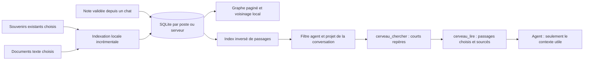

# KLYRA — socle du second cerveau (V2)

La règle : **conserver beaucoup, indexer localement, ne lire chez le modèle que les passages nécessaires**. Le graphe est une vue pour explorer les connaissances ; ce n’est ni le stockage ni le contexte intégral du modèle.

Le code est dans `/var/lib/klyra/atelier/principal/klyra-memoire`, branche `prototype/memoire-a07e528f`. Cette V2 est construite et testée dans une app Electron avec un profil jetable. **Elle n’a pas été déployée dans l’app installée ni sur le serveur en production. Aucune donnée réelle de Corentin n’a été importée.**

## Ce que KLYRA avait déjà

Les sources du dépôt montrent trois briques distinctes :

- `electron/connaissances-agent.ts` sait lire les souvenirs Markdown de Claude, leur portée et leur index `MEMORY.md`. Le panneau existant permet déjà de les consulter et de les modifier, sur le poste ou le VPS.
- `src/lib/contexte.ts` gère le poids et le résumé des conversations. Ce contexte de travail n’est pas une base documentaire.
- `electron/superagent/recherche.ts` indexe des pointeurs vers des travaux et des décisions dans le journal du super-agent. Cet index n’est pas encore fédéré avec celui de cette V2.

La V2 conserve ces systèmes. Les souvenirs originaux restent dans leurs dossiers. Une action explicite les rend cherchables dans le second cerveau. Les instructions, skills et fichiers privés du poste ne sont pas parcourus automatiquement.

Le réglage existant de mémoire automatique n’est pas changé. S’il charge déjà un index de mémoire dans les prompts, ce coût reste présent : le gain global doit être mesuré avec cette configuration réelle.

## Architecture mise en place



### Stockage et provenance

Le nouveau stockage est `cerveau/connaissances.sqlite`, sous le profil de l’app pour le poste, ou sous les données du VPS sélectionné. Le PC appelle ce VPS par le pont authentifié de KLYRA ; il ne fait pas passer ces connaissances par Convex.

SQLite garde les notes, leurs connexions, les copies textuelles importées et l’index. Les écritures sont transactionnelles ; les suppressions nettoient aussi les connexions et l’index des passages. Une révision empêche d’écraser une note modifiée depuis son ouverture.

Les souvenirs et documents importés sont des copies indexées en lecture seule : modifier le fichier source puis le réindexer. Les notes créées dans KLYRA se modifient dans la page. Les fichiers d’origine ne sont pas modifiés.

Les références de passages sont compactes et dépendent du contenu et de sa version. Une ancienne référence ne peut pas lire silencieusement une version différente, même après oubli puis réimport du document.

### Découpage et index

Les contenus sont divisés en passages de **1 800 octets UTF-8 au plus**, sans couper un caractère Unicode. Chaque passage garde ses lignes, sa note d’origine et sa version.

L’index inversé utilise les tables et index SQLite ordinaires. Il ne nécessite pas FTS5, absent du Node 22 livré sur ce VPS lors du contrôle. Il normalise les accents et classe les passages selon les mots trouvés et leur présence dans les titres. Il évite qu’un seul document occupe tous les résultats.

La recherche est **lexicale** : elle ne comprend pas les synonymes, les paraphrases ou les contradictions comme le ferait une recherche sémantique. Elle ne génère ni faits, ni résumés, ni relations supposées. Les liens du graphe restent explicites.

Les imports inchangés ne reconstruisent pas leurs passages. Une réindexation complète d’un dossier de souvenirs écarte des recherches les fichiers qui ont disparu de cette source, en conservant leur ancienne copie dans la base. Une lecture porte donc sur une **version indexée**, pas sur une garantie de mise à jour instantanée du fichier original.

L’indexation des souvenirs rend la main à la boucle d’événements par petits lots. Une indexation initiale reste un travail de disque et de CPU ; les très gros imports et documents devront être évalués en worker avant une généralisation.

### Ce qui arrive au modèle

Deux outils MCP en lecture seule sont ajoutés aux connexions locales et serveur :

1. **`cerveau_chercher`** renvoie des références et de courts extraits.
2. **`cerveau_lire`** lit seulement les passages retenus, avec leur version et leurs lignes.

Le projet d’une conversation est résolu côté serveur depuis la conversation enregistrée. Un argument fourni par l’agent ne peut pas élargir ce projet. Un agent retrouve les notes partagées accessibles dans ce périmètre et ses propres souvenirs indexés, pas les souvenirs privés d’un autre agent. La page de la personne peut examiner tous ses contenus et prévisualiser le périmètre d’un agent.

Ces filtres organisent la consultation par les outils. Ils ne remplacent pas les droits du système de fichiers qu’une personne aurait déjà accordés à un agent.

Aucun contenu du corpus n’est injecté systématiquement dans chaque prompt. Les descriptions des deux outils constituent toutefois un petit coût fixe lorsqu’elles sont présentées au modèle.

Le plafond par défaut est de **4 096 octets de JSON par appel**, métadonnées comprises, réglable jusqu’à 16 384 octets. Le nombre de tokens affiché est une estimation `octets / 3`, explicitement signalée ; ce n’est pas le tokenizer du fournisseur. Plusieurs lectures dans une conversation cumulent leur coût : cette version ne fixe pas un budget global par tâche et ne garantit pas un montant de facture.

## La page Mémoire

Trois vues dans la navigation de klyra-app :

- **Graphe** : notes reliées, zoom, déplacement du fond, sélection, recherche dans l’index, fenêtre de 80 métadonnées et exploration des connexions directes d’une note. La lecture de son contenu est séparée de la liste. Le graphe n’essaie pas d’afficher tout le corpus à la fois.
- **Retrouver du contexte** : rechercher comme un agent ou comme propriétaire, choisir un projet et un budget, sélectionner des passages, puis voir ce qui serait lu. Cette prévisualisation ne fait pas d’appel de modèle.
- **Sources** : indexer les souvenirs d’un agent dans le contexte choisi ; importer des documents texte ; récupérer les notes du premier prototype en gardant leur sauvegarde.

Les imports de fichiers utilisent la sélection de fichiers du poste : Markdown, texte, CSV, JSON et journaux, vingt fichiers par sélection, 2 Mo par fichier texte. Quand un VPS est sélectionné, les copies lui sont envoyées par cette action explicite. Un même fichier inchangé n’est pas dupliqué à chaque import. Aucun dossier personnel ou compte externe n’est aspiré en arrière-plan.

Le menu **Garder en mémoire** d’un message reste disponible : relecture, choix du projet et des liens, puis conservation de la note avec sa source.

## Mesure effectuée

Corpus entièrement synthétique ; aucune donnée réelle. Test effectué avec `v22.12.0` sur ce VPS, sur des petits textes répétitifs. Les temps ne constituent pas une promesse de service et n’incluent pas le réseau, un appel de modèle ou la résolution d’un historique de conversation volumineux.

| Mesure | Résultat observé |
|---|---:|
| Documents et passages indexés | 10,000 / 10,000 |
| Texte source brut | 11,097,780 octets |
| Indexation initiale | 32.6 s |
| Recherche médiane, 40 requêtes alternées | 46.51 ms |
| Recherche au 95e percentile observé | 53.24 ms |
| Réponse à une recherche générique | 3,880 octets |
| Réponse à une recherche précise | 531 octets |
| Lecture du passage choisi | 1,464 octets |
| Plafond par appel dans ce test | 4,096 octets |
| Notes chargées pour la page du graphe | 80 sur 10,000 |
| Appels de modèle pour ces opérations | 0 |

Le texte source et la taille du fichier SQLite ne sont pas la même mesure : les copies, passages et index occupent du disque en plus. Ce test n’évalue pas la pertinence sémantique, un corpus multimédia ou des millions de documents. Il ne mesure aucune économie de facture par rapport à l’usage réel actuel de KLYRA.

## Contrôles réalisés

- Construction de l’app Next et compilation Electron.
- Lint du projet et conformité des modules serveur générés ; neuf avertissements préexistants dans un fichier du navigateur, aucun nouveau dans cette V2.
- Six tests du cœur, trois tests API/MCP/import et cinq tests de l’ancien stockage du prototype.
- Vingt-sept tests du serveur existant et dix-huit tests des connaissances et consommations existantes. Ces derniers sont lancés sans `KLYRA_USER_DATA` hérité pour rester sur leurs seules fixtures.
- Parcours dans la vraie fenêtre Electron, sur un profil jetable : menu du message, stockage, rechargement, lien source exact, modification, conflit de version, suppression, graphe local, indexation d’une mémoire existante et import texte par le traitement de fichiers du poste. Le sélecteur de fichiers du harnais est dirigé vers un fichier de test.
- Recherche puis lecture d’un souvenir indexé, avec référence et budget visibles. Rendu sans débordement horizontal aux largeurs 1 440, 768 et 390 px.
- Original des souvenirs et du document importé conservé ; aucun lancement de modèle ni connexion de compte lors des tests.

Les captures jointes viennent de ce profil de démonstration, pas du compte réel. Le sélecteur de fichiers sur l’ordinateur de Corentin, un lecteur d’écran, la charge multi-utilisateur et le déploiement réel n’ont pas été vérifiés.

## Ce qui reste pour la suite

1. **Déployer après validation.** Aucun installateur n’a été exécuté. Le code de l’installateur connaît les nouveaux modules et détecte le drapeau SQLite nécessaire sous Node 22 ; seule sa syntaxe et sa liste de dépendances ont été vérifiées.
2. **Sauvegarde et export portables.** Le stockage est durable sur sa machine ; cela ne remplace pas une sauvegarde cohérente et restaurable. Fréquence, rétention et restauration : [à compléter]. Il n’y a pas encore de synchronisation automatique entre le poste et plusieurs serveurs.
3. **Sources supplémentaires.** PDF, images, audio, mails, Notion et autres apps ne sont pas encore connectés. Les historiques complets et le journal des travaux ne sont pas fédérés automatiquement dans cet index.
4. **Actualisation et gros volumes.** Les imports sont explicites. Surveiller les changements, ajouter des workers, tester un vrai grand corpus et définir la purge des copies obsolètes restent à faire. L’inventaire de souvenirs est borné à 20 000 fichiers et à la profondeur de dossiers du système existant ; un inventaire incomplet est signalé.
5. **Qualité de recherche.** Une recherche hybride ou un reranking ne se justifieront qu’après mesure des requêtes manquées. Ne pas payer un modèle à chaque document ni à chaque frappe par défaut. Jeu de questions réelles et sources prioritaires : [à compléter].
6. **Mesurer le coût de bout en bout.** Compter les tokens réellement facturés, la précision des sources et les appels par tâche, en tenant compte des mémoires déjà chargées et des descriptions d’outils. Aucune promesse chiffrée d’économie n’est faite ici.

## Reproduction dans le projet

```sh
npm run build
npm run build:electron
npm run lint
npm run test:cerveau
node_modules/.bin/vitest run src/lib/memoire.test.ts
env -u KLYRA_USER_DATA npm run test:connaissances
node --experimental-sqlite --test serveur/klyra-serveur.test.mjs
xvfb-run -a node scripts/test-memoire.mjs --no-sandbox
npm run bench:cerveau
```

Les commandes utilisent les dépendances présentes. Sur ce VPS, le Node est dans `/var/lib/klyra/node/bin`. Les tests créent leurs propres profils et dossiers ; ils ne mettent rien en production. `--no-sandbox` concerne uniquement ce harnais Electron Linux.

Le cœur est dans `electron/cerveau.ts`, ses outils dans `electron/cerveau-outils.ts`, le raccord aux souvenirs et documents dans `electron/cerveau-service.ts` et la page dans `src/components/memoire/CerveauGestion.tsx`. Les homologues `.mjs` du serveur sont produits par `scripts/serveur-genere.mjs`.

Documentation primaire consultée pour les mécanismes : [API SQLite de Node](https://nodejs.org/api/sqlite.html) et [SQLite FTS5, disponibilité selon la compilation](https://sqlite.org/fts5.html). Le choix de ne pas dépendre de FTS5 repose aussi sur le contrôle exécuté avec le runtime de ce VPS.


## DIGITAL-OS comme dossier source

Le fonds documentaire peut être connecté en tant que dossier entier dans la vue Sources, avec son arborescence. Sur le poste, la personne choisit ce dossier ; sur le serveur, la racine est `DIGITAL-OS` sous le dossier personnel du service. Aucun chemin arbitraire reçu par HTTP n’est ouvert.

Le module `electron/cerveau-dossiers.ts` et son homologue serveur gardent un catalogue durable, un état de scan, les dates et tailles des fichiers et leur lien avec l’index. L’exploration retourne cent entrées à la fois. Le scan est lancé explicitement, fonctionne par lots, peut être arrêté et peut être relancé après interruption. L’actualisation rapide compare date et taille ; une option revérifie aussi les contenus.

Les fichiers texte reconnus de 2 Mo au plus deviennent des passages. Pour les pièces jointes, les fichiers trop volumineux, vides ou non textuels, un repère indexé annonce explicitement que le contenu n’est pas extrait : le nom et le chemin sont cherchables, pas le contenu supposé. Les archives sont conservées, signalées comme historiques et pénalisées à couverture de recherche égale. Les chemins contribuent à l’index pour retrouver les domaines, clients et capsules sans les renommer.

Les fichiers d’origine ne sont ni modifiés ni déplacés. Les copies Git, dépendances, builds et caches courants sont écartés du parcours ; leurs entrées restent identifiables dans l’explorateur. Les liens symboliques ne sont pas suivis par l’indexeur. Les chemins habituels de secrets et quelques signatures de clés connues sont protégés sans renvoyer leurs valeurs ; ce garde n’est pas une détection exhaustive des secrets. Les contenus de dossiers ne deviennent jamais des instructions système.

L’accès aux extraits du fonds est limité à l’assistant principal par défaut. La mise en correspondance des capsules DIGITAL-OS avec les identifiants de projets KLYRA et leur partage granulaire avec les autres agents restent à définir. Le graphe n’invente pas de liens sémantiques entre les fichiers importés.

La surveillance automatique, les extracteurs de contenus PDF/images/audio/mails et la synchronisation de la copie d’un ordinateur avec celle d’un serveur ne sont pas implémentés par cette connexion. Une suppression d’entrée dans l’index n’efface pas son original et un prochain scan de la source peut la recréer. Il faut dimensionner et mesurer l’indexation d’un vrai grand fonds avant déploiement.

Vérifications de cette extension : cinq tests de dossier en plus des six tests du cœur et trois tests API/MCP, dont connexion HTTP à la seule racine attendue, recherche par chemin, pièces repérées, original inchangé, secrets exclus, bornes de chemin, actualisation et disparition, arrêt et pagination. Le parcours Electron connecte et indexe un dossier fictif sélectionné dans le harnais. Aucun fonds réel n’a été indexé pour ces tests.
